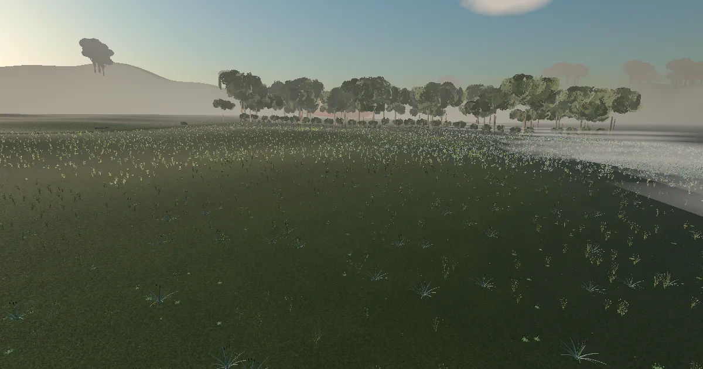

# Field Ecologist: Sampling the Meadow

> **Evaluation status (v3.0.0, 2026-11-09):** Automated functional, accessibility and performance testing is complete (headed GPU audit on an Apple M1, unit and browser tests). v3 had no agent design reviews (the owner chose a lean process); earlier versions' agent reviews are in `evaluation/reviews/`. The owner reviewed the v3 scene and approved it on 2026-11-09; that is owner visual approval, not user testing. No real learners have tested this yet. No physical phone testing has been done (mobile was checked with device emulation). Known open issues at v3.0.0 are listed in [STATUS.md](STATUS.md). See `evaluation/METHODS.md`.

**Play:** https://immersive-learning-showcase.vercel.app/play/field-ecologist/

## The problem

Sampling, bias and uncertainty are core research-methods concepts, but students meet them as formulas. The one thing a real field course can never show — the *true* population you are estimating — is exactly what a simulation can show. This module makes bias and variance concrete by letting learners design a quadrat survey of a realistic meadow, then revealing the truth their sample missed.

## Audience

Grades 9–12 biology and environmental science; first-year undergraduates in research methods or ecology labs. Designed for one 45–60 minute period as a pre-lab or field-work replacement (NGSS HS-LS2-2; Science Practices 3–5 — see `research/sources.md` for the verified standard wording).

## Approach

Five modules around a field-sampling game on a seeded, 100 m × 100 m teaching meadow:

1. **The question** — dawn arrival (skippable cinematic), hypothesis choice, 5-item pre-check.
2. **Know your species** — HTML field guide (shape → size → leaf → colour marks) and an 8-item ID quiz.
3. **Fieldwork** — pick a design (simple random / systematic / stratified by moisture zone / *"wherever looks interesting"* — the deliberately biased one), place 10 quadrats within a walking-time budget, identify species in a top-down counting view, enter counts and percent-cover bands, export the data sheet as CSV.
4. **The reveal** — the true population beside the learner's estimate, then a re-sampling simulator (Web Worker, 1,000 virtual samples per run, n = 5–40) showing the sampling distribution per design, with charts that always ship with data tables.
5. **Report & transfer** — a methods-and-results report from the learner's own data, a rubric self-check (never auto-graded), and four survey-sampling transfer items.

The meadow population is generated from one documented seed: a clumped (Thomas process) showy species, a random Poisson herb, a moisture-gradient sedge, a dense cover grass and a rare clumped orchid — the distribution patterns are what make sampling design matter.

## v3.0.0: the field notebook
- **Navigation:** a collapsible notebook rail on the left (56 px at rest, 196 px open, horizontal labels), with **Back** (the previous screen), **Back to start** (the intro) and the menu at its foot; on phones it becomes a bottom tab strip. Paper field-guide cards. Project pages don't link to other projects.
- **Fieldwork in the scene:** press, drag and release to place a quadrat (mouse and touch; Place by map for the keyboard); the hand lens always lands on a drawn plant; a kneeling camera at each quadrat and a clipboard that fills as you count.
- **Purposeful interaction:** only course objects (11 task, 3 learn, including the soil and the stream) open cards; insects, clouds, mist and the other 14 decorative objects open nothing.
- **Performance (headed Chromium on an Apple M1 GPU, Medium, every module state at four viewports):** at most 12.95 ms GPU p95 (the north-hedge view at 1440×900, over the 12 ms budget; every other cell within it), 60 fps, at most 287 draw calls and 1.25 M triangles, 5.78 MB before the first interaction.

## v2.0.0: Ashcombe Meadow at dawn

The 3D meadow is now a living place: a dry-stone wall and open gate, a flowing stream, a hedgerow and hills, gusts rolling across the grass, butterflies over the margins, pollen, thinning morning mist, cloud shadows and a field ecologist at the station. The five counted species are still fictional; the real Poly Haven plants are background only and sit outside the sampled field (see `design/art-bible.md`).

## Key design decisions

- **A known "truth"** (seeded population model) instead of hand-placed plants — it is what makes the reveal possible. Parameters and seed in `design/ecology-model.md`.
- **A biased design included on purpose.** Experiencing "wherever looks interesting" overestimate Butterweed teaches more than being told about bias; the reveal and simulator make it visible (the modelled convenience sampler is +369 % biased at n = 10 and still +365 % at n = 40, on 1,000 virtual samples).
- **Top-down counting view with wind reduced to ~12 %** inside the quadrat (paused under reduced motion) — movement makes counting harder for no learning gain (realism matrix §6.1).
- **Re-sampling simulator, not formulas** — the sampling distribution emerges from 1,000 repeats of the learner's own design.
- **Survey-sampling transfer** — the last module maps quadrat logic onto school-survey sampling.
- Full parity **text mode**: the meadow as a 20 × 20 grid data table with a moisture-zone column; the same session, assessment and record drive both modes.

## Evidence & evaluation

- **176 unit tests** (vitest, v3.0.0): generated populations match their parameters; unbiased designs converge on the truth; the modelled convenience design is biased (unit test asserts > +25 %; measured +369 % on Butterweed at n = 10, re-measured 2026-10-27); stratification reduces Sedge variance; the true Bunchgrass cover matches the drawn tussock size; no species' identifying geometry sits below the ground; the CSV is RFC 4180-correct.
- **Browser tests** (Playwright, v3.0.0): 23 of 24 pass, including the full playthrough, text-mode parity, CSV checks, axe scans, the rail, quadrat drag by mouse and touch, keyboard placement and the hand lens. The keyboard-only test for Module 3 part 1 hit its 5-minute cap (open, STATUS.md).
- **Agent-based design reviews** (v1 and v2; v3 had none, by the owner's lean process) (visual, realism/cinematics, cognitive walkthrough, multimedia, accessibility, heuristics, expert style — AI reviewers, not humans; reports in `evaluation/reviews/`). Their findings are fixed in code and logged with evidence as revisions R1–R7 in `DECISIONS.md`.
- **Accessibility**: axe scans (zero critical/serious) across the overlay, module panels, field guide dialog, settings/menu/progress dialogs and the text-mode grid; WCAG 2.1 AA targets; full keyboard operability; reduced-motion variants for every cinematic and the camera.
- **Sub-path build test**: the built app is served at `/play/field-ecologist/` with zero failed requests and zero console errors (the re-sampling Web Worker included).
- What testing can **not** show: learning gains, real-device performance on physical phones, and whether the fictional species read as plausible to domain experts — see `evaluation/METHODS.md` for the honest limitations.

## Accessibility

Text mode with full decision parity (the 20 × 20 grid map is a real data table); species field marks always state shape and size before colour (colourblind-safe, stated in the guide); charts always have data tables and text summaries; every cinematic is captioned, skippable from the first frame, with a reduced-motion still-frame version; quality presets scale vegetation density and effects for phones (Low preset keeps every counted plant visible inside the quadrat).

## Next steps

- Real-learner playtests using `evaluation/human-protocol/` (consent + session templates ready).
- Teacher-guide classroom pilot (`design/teacher-guide.md`).
- Optional: GPS/field-trip companion mode mapping the quadrat flow onto a real schoolyard.

## Tools

Built with three.js 0.186.1 (instanced vegetation, custom wind shader, orthographic counting view), Vite 8, pmndrs postprocessing + N8AO, a Web Worker re-sampler, vitest and Playwright. One CC0 Poly Haven HDRI (`belfast_open_field`, recorded in `ATTRIBUTION.md`); everything else is procedural original work. Species are fictional and labeled as a teaching model in-app.

## License

Code MIT (`LICENSE`), content CC BY 4.0 (`LICENSE-CONTENT`), assets CC0 or original — see `ATTRIBUTION.md`.

## Trailer

**Trailer:** [docs/trailer.webm](docs/trailer.webm) (57 s, recorded from v2.0.0, so it doesn't show the v3 scene; captioned; WebVTT sidecar at [docs/trailer.vtt](docs/trailer.vtt)). Recorded from the real app on the Mac GPU; the caption text is also in the sidecar file.
